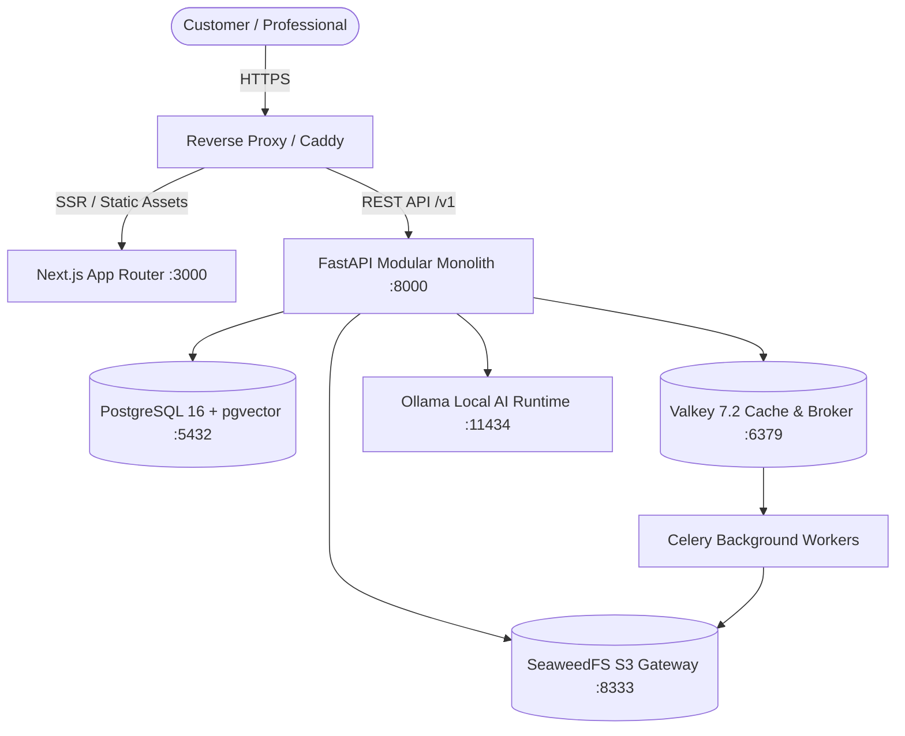

# MAANCAMERA — India's AI-Powered Photography & Videography Marketplace

> **Discover. Compare. Connect. Capture.**  
> *India-first, AI-powered two-sided marketplace and business SaaS platform for creative visual professionals.*

---

## 1. Product Overview

MaanCamera connects customers seeking trusted wedding, portrait, commercial, and cinematic coverage with verified photographers, videographers, drone pilots, and post-production studios across India.

### Three Interconnected Products
1. **Customer Marketplace**: Explore curated portfolios, filter by city and budget, run conversational AI searches, compare up to 4 candidates side-by-side, send direct enquiries, accept quotations, confirm bookings, and write verified reviews.
2. **Professional Business Platform (SaaS)**: Digital studio identity, structured portfolio management, lead inbox, versioned quotation builder, calendar availability management, and client invoicing.
3. **AI Intelligence Platform**: Natural-language requirement parsing, visual portfolio tagging, 7-factor weighted candidate ranking, and verified review summarization.

---

## 2. Free & Open-Source Engineering Mandate

MaanCamera is built strictly upon **free and open-source software (FOSS)** with **zero mandatory paid software subscriptions, proprietary paid dependencies, or paid developer tool lock-in**:

| Layer | Open-Source Technology | License | Replacement for Proprietary Equivalent |
| :--- | :--- | :--- | :--- |
| **Frontend** | React 18 / Next.js 14 / TypeScript / Tailwind | MIT / Apache-2.0 | Paid UI kits |
| **Backend API** | Python 3.11 / FastAPI / Uvicorn / SQLAlchemy | MIT / BSD | Proprietary SaaS backends |
| **Relational Database** | PostgreSQL 16 | PostgreSQL License | AWS RDS / Supabase paid tiers |
| **Vector Database** | pgvector extension | PostgreSQL License | Pinecone managed vector DB |
| **Cache & Queue Broker** | Valkey 7.2 | BSD-3-Clause | Commercial Redis Enterprise |
| **Object Storage** | SeaweedFS (S3-Compatible Gateway) | Apache-2.0 | AWS S3 proprietary buckets |
| **Local AI Runtime** | Ollama (Local LLM inference & embeddings) | MIT | OpenAI / Anthropic / Gemini Paid APIs |
| **Background Processing**| Celery 5.3 + Valkey | BSD-3-Clause | Proprietary cloud task queues |

*See [LICENSE_POLICY.md](file:///./LICENSE_POLICY.md), [DEPENDENCY_ALLOWLIST.md](file:///./DEPENDENCY_ALLOWLIST.md), and [MODEL_LICENSES.md](file:///./MODEL_LICENSES.md) for full compliance audits.*

---

## 3. High-Level Architecture



---

## 4. Repository Structure

```
MaanCamera/
├── .github/
│   └── workflows/ci.yml         # Automated GitHub Actions CI pipeline
├── api/
│   └── openapi.yaml             # Complete OpenAPI 3.1.0 REST API specification
├── database/
│   ├── schema.sql               # PostgreSQL 16 schema (32 tables + pgvector + RLS)
│   └── seed.sql                 # Indian marketplace seed data (Pune, Mumbai, Delhi)
├── backend/
│   ├── app/
│   │   ├── core/                # Config, database, security, exceptions, responses
│   │   ├── modules/             # Identity, Professionals, Portfolios, Search,
│   │   │                        # Enquiries, Quotations, Bookings, Payments, Reviews, AI
│   │   ├── integrations/        # Storage (SeaweedFS S3), AI Runtime (Ollama)
│   │   ├── workers/             # Celery async media & embedding worker tasks
│   │   └── main.py              # FastAPI app mounting routers & middlewares
│   ├── Dockerfile
│   └── pyproject.toml
├── frontend/
│   ├── app/                     # Next.js 14 App Router pages (Public, Search, Dashboards)
│   ├── components/              # Navbar, Footer, Professional Cards
│   ├── lib/api.ts               # Typed frontend REST client
│   ├── tailwind.config.ts
│   └── package.json
├── docs/                        # Complete 9-part architecture & engineering documentation
│   ├── 01_PRODUCT/              # Vision, PRD, Roadmap
│   ├── 02_ARCHITECTURE/         # HLD, LLD, Database design, ADRs
│   ├── 03_AI_ENGINEERING/       # Recommendation engine, safety, model selection
│   ├── 04_SAAS/                 # Multi-tenancy, billing, subscriptions
│   └── 08_COMPLIANCE/           # India DPDPA 2023, copyright, privacy
├── .env.example                 # Comprehensive environment variable blueprint
├── docker-compose.yml           # Multi-container orchestration stack
├── docker-compose.dev.yml       # Local development overrides
├── LICENSE                      # MIT License
├── LICENSE_POLICY.md            # Free & Open Source engineering governance
├── DEPENDENCY_ALLOWLIST.md      # Approved license criteria
├── MODEL_LICENSES.md            # Open-source AI models & commercial permissions
├── SECURITY.md                  # Vulnerability disclosure & cryptographic standards
└── CONTRIBUTING.md              # Engineering setup & pull request rules
```

---

## 5. Quickstart & Local Setup

### Prerequisites
- Docker Engine & Docker Compose (v2.20+)
- Python 3.11+
- Node.js 20+ & pnpm
- Git

### Step 1: Clone and Configure Environment
```bash
git clone https://github.com/rehan0018/MaanCamera.git
cd MaanCamera

# Copy example environment configuration
cp .env.example .env
```

### Step 2: Start Infrastructure via Docker Compose
```bash
docker compose up -d postgres valkey seaweedfs ollama
```

*This spins up PostgreSQL 16 with pgvector (auto-loading `schema.sql` and `seed.sql`), Valkey 7.2 on port 6379, SeaweedFS S3 on port 8333, and Ollama on port 11434.*

### Step 3: Run the Modular Backend
```bash
cd backend
python -m venv .venv
source .venv/bin/activate  # On Windows: .venv\Scripts\activate
pip install -e .

uvicorn app.main:app --host 0.0.0.0 --port 8000 --reload
```
- Interactive API Documentation: [http://localhost:8000/docs](http://localhost:8000/docs)
- OpenAPI Specification: [http://localhost:8000/api/v1/openapi.json](http://localhost:8000/api/v1/openapi.json)

### Step 4: Run the Next.js Frontend
```bash
cd ../frontend
pnpm install
pnpm dev
```
- Web Application: [http://localhost:3000](http://localhost:3000)

---

## 6. Seed Accounts for Local Testing

| Role | Email | Password | Location |
| :--- | :--- | :--- | :--- |
| **Customer** | `arjun.mehta@example.com` | `DevPass@2026!` | Pune, MH |
| **Professional (Studio)** | `contact@auraweddings.com` | `DevPass@2026!` | Pune, MH |
| **Professional (Commercial)**| `studio@drishtivisuals.com` | `DevPass@2026!` | Mumbai, MH |
| **Admin / Moderator** | `admin@maancamera.com` | `DevAdmin@2026!` | Platform-wide |

---

## 7. AI Recommendation Engine: 7-Factor Weighted Scoring

Candidate relevance is ranked via an evidence-grounded scoring formula:

$$\text{Score} = 0.25S + 0.20V + 0.15R + 0.15B + 0.10A + 0.10E + 0.05T$$

Where:
- **$S$**: Skills & Category Match (0-100)
- **$V$**: Visual Portfolio Semantic Similarity via pgvector (0-100)
- **$R$**: Verified Review Quality from Completed Bookings (0-100)
- **$B$**: Budget Range Envelope Suitability (0-100)
- **$A$**: Calendar Availability for Requested Dates (0-100)
- **$E$**: Years of Documented Professional Experience (0-100)
- **$T$**: Identity, GST, and Booking Verification Trust Score (0-100)

---

## 8. India Regulatory & DPDPA 2023 Compliance
- **Digital Personal Data Protection Act, 2023**: Purpose limitation, granular customer consent, and right to erasure.
- **EXIF Sanitization**: Sensitive GPS coordinates and camera hardware serials stripped from public derivative assets.
- **Strict Review Authenticity**: Reviews can ONLY be submitted by clients holding verified, completed bookings.

---

## 9. License

This project is licensed under the **MIT License** — see the [LICENSE](file:///./LICENSE) file for details.
