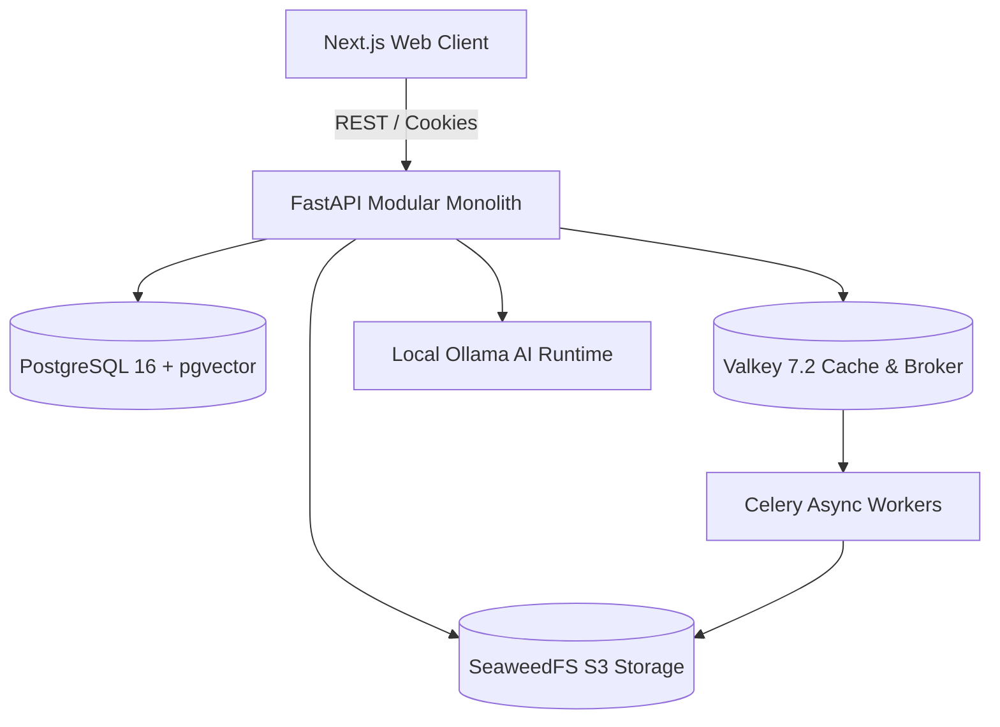

# High-Level Design (HLD)

**Document ID:** MC-HLD-001  
**Version:** 1.0  
**Architecture:** Modular Monolith with Self-Hosted Infrastructure  

---

## 1. System Overview

MaanCamera is architected as an event-ready Modular Monolith running Python FastAPI on the backend and React/Next.js on the frontend, supported by open-source distributed services:

---

## 2. Technology Stack & Open-Source Licensing

| Layer | Technology | License |
| :--- | :--- | :--- |
| **Frontend** | Next.js 14, React 18, Tailwind CSS, Lucide | MIT |
| **Backend API** | Python 3.11, FastAPI, Uvicorn, Pydantic v2 | MIT / BSD |
| **Database** | PostgreSQL 16 + pgvector + pg_trgm | PostgreSQL License |
| **Cache & Queue** | Valkey 7.2 (BSD-3-Clause Redis fork) | BSD-3-Clause |
| **Background Jobs** | Celery 5.3 | BSD-3-Clause |
| **Object Storage** | SeaweedFS (S3 compatible distributed storage) | Apache-2.0 |
| **AI Inference** | Ollama (Local LLM / Embeddings) | MIT |
| **Reverse Proxy** | Caddy / Nginx | Apache-2.0 / BSD |
