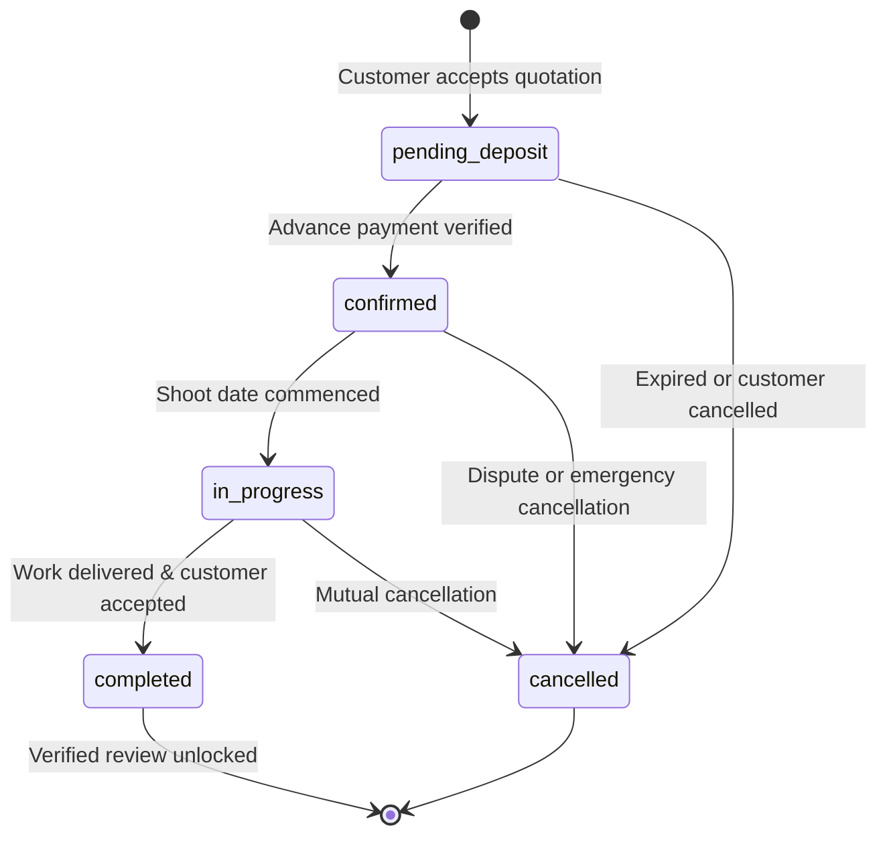

# Low-Level Design (LLD)

**Document ID:** MC-LLD-001  
**Version:** 1.0  

---

## 1. Modular Monolith Architecture

The backend code is organized into isolated, domain-driven modules inside `backend/app/modules/`:

```
modules/
├── identity/       # Users, sessions, Argon2id passwords
├── professionals/  # Profiles, multi-categories, skills, equipment, services
├── portfolios/     # Portfolios, projects, media asset storage keys
├── search/         # PostgreSQL full-text search & comparison matrix
├── enquiries/      # Customer requirements & multi-recipient dispatch
├── quotations/     # Digital quotes, revisions, immutable acceptance
├── bookings/       # State machine (pending -> confirmed -> completed)
├── payments/       # Gateway adapter (Mock & Razorpay), webhook idempotency
├── reviews/        # Verified booking feedback & rating recalculation
└── ai/             # Ollama extraction, 7-factor weighted candidate scoring
```

Each module adheres to a strict separation of concerns:
- `router.py`: Handles HTTP interface, validation, request/response serialization.
- `schemas.py`: Pydantic input and output data contracts.
- `models.py`: SQLAlchemy ORM database models.
- `service.py`: Encapsulates business logic and transactional boundaries.

---

## 2. Booking Concurrency & State Machine



### State Transition Rules
1. A completed booking cannot silently revert to confirmed.
2. Advance payment verification updates status from `pending_deposit` to `confirmed`.
3. Reviews are strictly disallowed unless status is `completed`.
