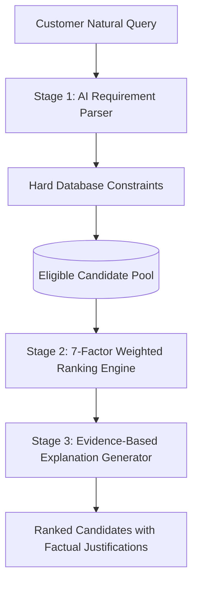

# AI Recommendation Engine & 7-Factor Ranking Specification

**Document ID:** MC-AI-002  
**Version:** 1.0  

---

## 1. Hybrid 3-Stage Architecture

---

## 2. Stage 1: Eligibility Filtering (Hard Constraints)
Candidates must satisfy non-negotiable database rules:
- **Category Match**: Professional offers services matching requested category.
- **Location Radius**: Professional base city matches or professional has `travel_available = true`.
- **Budget Ceiling**: If customer specifies hard maximum, candidate starting rate must be within eligible envelope.

---

## 3. Stage 2: 7-Factor Weighted Scoring Model

The candidate score is calculated via the normalized weighted equation:

$$\text{Score} = 0.25S + 0.20V + 0.15R + 0.15B + 0.10A + 0.10E + 0.05T$$

Where all sub-scores are normalized from $0.0$ to $100.0$:
- **$S$ (Skills & Category Match)**: Exact category and requested equipment overlap.
- **$V$ (Visual Portfolio Similarity)**: Semantic similarity between requested mood and published portfolio assets.
- **$R$ (Verified Review Quality)**: Weighted average rating and positive sentiment ratio from completed bookings.
- **$B$ (Budget Suitability)**: Proximity to requested budget range.
- **$A$ (Calendar Availability)**: Confirmed availability on requested shoot date.
- **$E$ (Relevant Experience)**: Verified years of professional industry practice.
- **$T$ (Trust & Verification Status)**: Triple verification score (Identity, GST, past completions).

---

## 4. Stage 3: Grounded Explanation Engine
AI generated match recommendations must always cite concrete facts from the database:
- Example: *"Recommended because this studio has 8 years of experience in Pune, a 4.92★ rating across 48 verified bookings, and their package includes cinematic drone video within your budget."*
- **Strict Guardrail**: The system never hallucinates nonexistent professional IDs, unverified ratings, or false availability.
